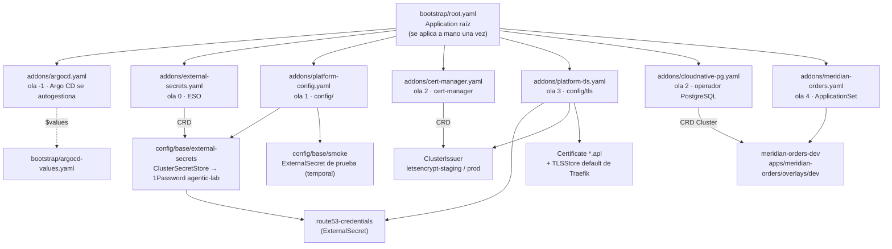

# platform-gitops

> **El clúster es lo que dice este repo.** Ni personas ni agentes aplican manifiestos a mano.

Estado deseado del clúster `k3s01` del [agentic-platform-lab](https://github.com/elpalmeral-org/agentic-platform-lab):
addons de plataforma y, desde la fase 2, los entornos de la aplicación de ejemplo. Lo reconcilia
**Argo CD** con el patrón *app-of-apps*.



## Estructura

```
├── bootstrap/
│   ├── argocd-values.yaml   ← valores de Argo CD (bootstrap y autogestión usan el mismo fichero)
│   └── root.yaml            ← Application raíz: apunta a addons/
├── addons/                  ← una Application por addon; el orden lo marcan las sync-waves
│   ├── argocd.yaml          ← ola -1
│   ├── external-secrets.yaml← ola 0
│   ├── platform-config.yaml ← ola 1 → config/base
│   ├── cert-manager.yaml    ← ola 2
│   ├── cloudnative-pg.yaml  ← ola 2
│   ├── platform-tls.yaml    ← ola 3 → config/tls
│   └── meridian-orders.yaml ← ola 4 · ApplicationSet (un entorno por elemento)
└── config/                  ← recursos que dependen de los CRD de los addons
    ├── base/                ← ola 1: ClusterSecretStore, pruebas temporales
    └── tls/                 ← ola 3: credenciales Route 53, ClusterIssuer, comodín, TLSStore
apps/
└── meridian-orders/
    ├── base/                ← Cluster CNPG · Job de migración · backend · frontend · Ingress
    └── overlays/dev/        ← namespace, host e imágenes POR DIGEST
scripts/
└── set-meridian-images.sh   ← resuelve en GHCR el digest de un tag y lo fija en un overlay
```

## Oleadas

| Ola | Qué | Estado |
|---|---|---|
| -1 | Argo CD (`argo-cd` 10.10.5 · v3.5.5) | ✅ |
| 0 | External Secrets Operator 2.13.0 | ✅ |
| 1 | `ClusterSecretStore` de 1Password + prueba de humo | ✅ |
| 2 | cert-manager v1.21.2 (comprobación DNS-01 por DoH) | ✅ #1 |
| 3 | `ClusterIssuer` staging/prod, comodín `*.apl` y TLS por defecto en Traefik | ✅ #1 (staging) · 🟡 prod en PR 2 |
| 4 | Ingress HTTPS de Argo CD (PR 2) · Kyverno y cuotas | ✅ / ⏸️ |
| 2 | CloudNativePG 0.29.1 (operador 1.30.1) | 🟡 PR `feat/meridian-dev` |
| 4 | Meridian Orders · dev (`orders-dev.apl.elpalmeral.es`) | 🟡 PR `feat/meridian-dev` |

## Reglas

- **Público:** ningún secreto, ni cifrado. Los secretos llegan por `ExternalSecret` desde 1Password;
  aquí solo hay **referencias** (`<elemento>/<campo>`).
- **Versiones fijadas** (`targetRevision` exacto). Actualizar un addon es un PR.
- **Todo cambio por PR**: el merge a `main` es el despliegue.

Cómo se arrancó la primera vez: [paso 05 del setup](https://github.com/elpalmeral-org/agentic-platform-lab/blob/main/docs/setup/paso-05-bootstrap-gitops.md).
