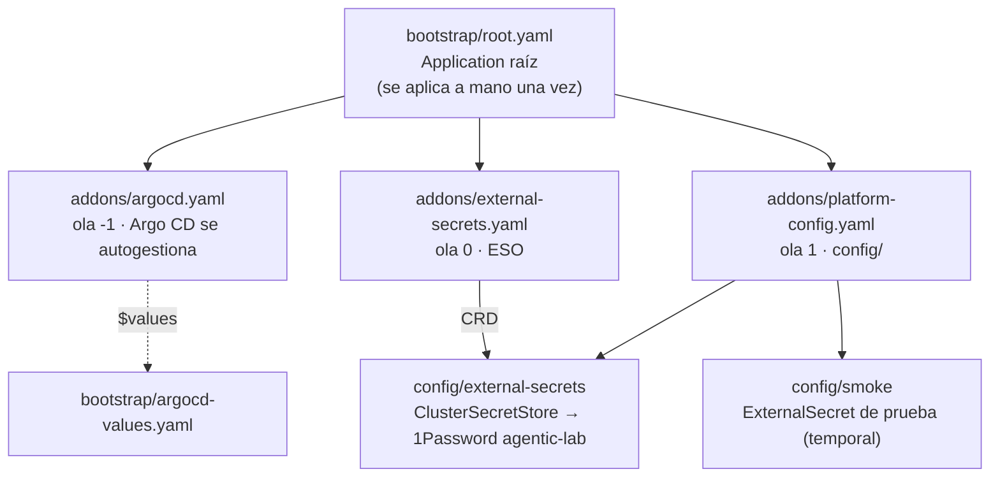

# platform-gitops

> **El clúster es lo que dice este repo.** Ni personas ni agentes aplican manifiestos a mano.

Estado deseado del clúster `k3s01` del [agentic-platform-lab](https://github.com/elpalmeral-org/agentic-platform-lab):
addons de plataforma y, desde la fase 2, los entornos de la aplicación de ejemplo. Lo reconcilia
**Argo CD** con el patrón *app-of-apps*.



## Estructura

```
├── bootstrap/
│   ├── argocd-values.yaml   ← valores de Argo CD (bootstrap y autogestión usan el mismo fichero)
│   └── root.yaml            ← Application raíz: apunta a addons/
├── addons/                  ← una Application por addon; el orden lo marcan las sync-waves
│   ├── argocd.yaml          ← ola -1
│   ├── external-secrets.yaml← ola 0
│   └── platform-config.yaml ← ola 1 → config/
└── config/                  ← recursos que dependen de los CRD de los addons
    ├── external-secrets/
    └── smoke/               ← pruebas temporales
```

## Oleadas

| Ola | Qué | Estado |
|---|---|---|
| -1 | Argo CD (`argo-cd` 10.10.5 · v3.5.5) | 🟡 paso 05 |
| 0 | External Secrets Operator 2.13.0 | 🟡 paso 05 |
| 1 | `ClusterSecretStore` de 1Password + prueba de humo | 🟡 paso 05 |
| 2 | cert-manager + `ClusterIssuer` Let's Encrypt (DNS-01, Route 53) | ⚪ |
| 3 | Certificado comodín y TLS por defecto en Traefik | ⚪ |
| 4 | Ingress HTTPS de Argo CD, Kyverno, cuotas | ⚪ |

## Reglas

- **Público:** ningún secreto, ni cifrado. Los secretos llegan por `ExternalSecret` desde 1Password;
  aquí solo hay **referencias** (`<elemento>/<campo>`).
- **Versiones fijadas** (`targetRevision` exacto). Actualizar un addon es un PR.
- **Todo cambio por PR**: el merge a `main` es el despliegue.

Cómo se arrancó la primera vez: [paso 05 del setup](https://github.com/elpalmeral-org/agentic-platform-lab/blob/main/docs/setup/paso-05-bootstrap-gitops.md).
