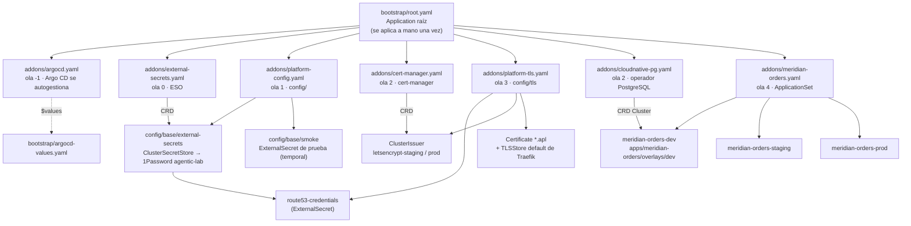
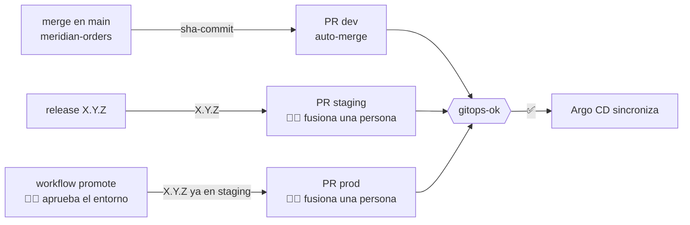

# platform-gitops

> **El clúster es lo que dice este repo.** Ni personas ni agentes aplican manifiestos a mano.

Estado deseado del clúster `k3s01` del [agentic-platform-lab](https://github.com/elpalmeral-org/agentic-platform-lab):
addons de plataforma y, desde la fase 2, los entornos de la aplicación de ejemplo. Lo reconcilia
**Argo CD** con el patrón *app-of-apps*.



## Estructura

```
├── bootstrap/
│   ├── argocd-values.yaml   ← valores de Argo CD (bootstrap y autogestión usan el mismo fichero)
│   └── root.yaml            ← Application raíz: apunta a addons/
├── addons/                  ← una Application por addon; el orden lo marcan las sync-waves
│   ├── argocd.yaml          ← ola -1
│   ├── external-secrets.yaml← ola 0
│   ├── platform-config.yaml ← ola 1 → config/base
│   ├── cert-manager.yaml    ← ola 2
│   ├── cloudnative-pg.yaml  ← ola 2
│   ├── platform-tls.yaml    ← ola 3 → config/tls
│   └── meridian-orders.yaml ← ola 4 · ApplicationSet (un entorno por elemento)
└── config/                  ← recursos que dependen de los CRD de los addons
    ├── base/                ← ola 1: ClusterSecretStore, pruebas temporales
    └── tls/                 ← ola 3: credenciales Route 53, ClusterIssuer, comodín, TLSStore
apps/
└── meridian-orders/
    ├── base/                ← Cluster CNPG · Job de migración · backend · frontend · Ingress
    └── overlays/            ← dev · staging · prod: namespace, host e imágenes POR DIGEST
scripts/
├── set-meridian-images.sh   ← resuelve en GHCR el digest de un tag y lo fija en un overlay
├── promote-meridian.sh      ← abre el PR de promoción a un entorno (lo llama el CD de la app)
└── validate.sh              ← reglas del check gitops-ok (se puede lanzar en local)
.github/workflows/
└── validate.yml             ← check obligatorio gitops-ok
```

## Oleadas

| Ola | Qué | Estado |
|---|---|---|
| -1 | Argo CD (`argo-cd` 10.10.5 · v3.5.5) | ✅ |
| 0 | External Secrets Operator 2.13.0 | ✅ |
| 1 | `ClusterSecretStore` de 1Password + prueba de humo | ✅ |
| 2 | cert-manager v1.21.2 (comprobación DNS-01 por DoH) | ✅ #1 |
| 3 | `ClusterIssuer` staging/prod, comodín `*.apl` y TLS por defecto en Traefik | ✅ #1 · #2 |
| 4 | Ingress HTTPS de Argo CD (PR 2) · Kyverno y cuotas | ✅ / ⏸️ |
| 2 | CloudNativePG 0.29.1 (operador 1.30.1) | ✅ #3 |
| 4 | Meridian Orders · dev (`orders-dev.apl.elpalmeral.es`) | ✅ #3 · automático desde F2.4b |
| 4 | Meridian Orders · staging (`orders-staging.apl.elpalmeral.es`) | ✅ #7 · #8 (`0.1.0`) |
| 4 | Meridian Orders · prod (`orders.apl.elpalmeral.es`) | ✅ #9 · #10 (`0.1.0`, 2 réplicas de API) |

## Promoción de Meridian Orders

El CI de la app **no toca el clúster**: llama a `scripts/promote-meridian.sh`, que abre un PR aquí.
Las reglas de promoción viven en este repo y las hace cumplir el check obligatorio `gitops-ok`.



| Regla (`scripts/validate.sh`) | Por qué |
|---|---|
| Entorno activo ⇒ imágenes fijadas por digest | lo que se despliega es inmutable |
| staging y prod solo `X.Y.Z` | a staging solo llegan releases |
| Si cambia prod, prod = staging | a prod solo llega lo que pasó por staging |
| Firma cosign de `publish.yml@main` | solo se despliega lo que construyó nuestro pipeline |
| kubeconform + shellcheck | manifiestos y scripts correctos antes de llegar a Argo CD |

## Reglas

- **Público:** ningún secreto, ni cifrado. Los secretos llegan por `ExternalSecret` desde 1Password;
  aquí solo hay **referencias** (`<elemento>/<campo>`).
- **Versiones fijadas** (`targetRevision` exacto). Actualizar un addon es un PR.
- **Todo cambio por PR**: el merge a `main` es el despliegue.

Cómo se arrancó la primera vez: [paso 05 del setup](https://github.com/elpalmeral-org/agentic-platform-lab/blob/main/docs/setup/paso-05-bootstrap-gitops.md).
